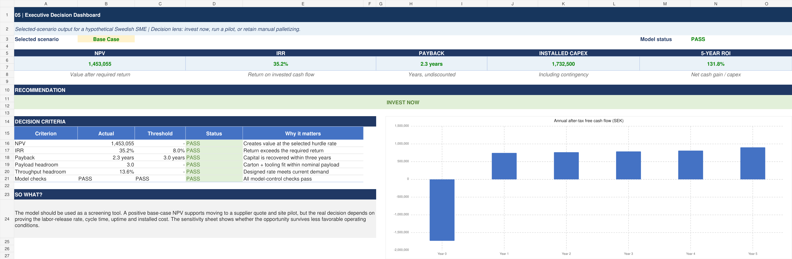
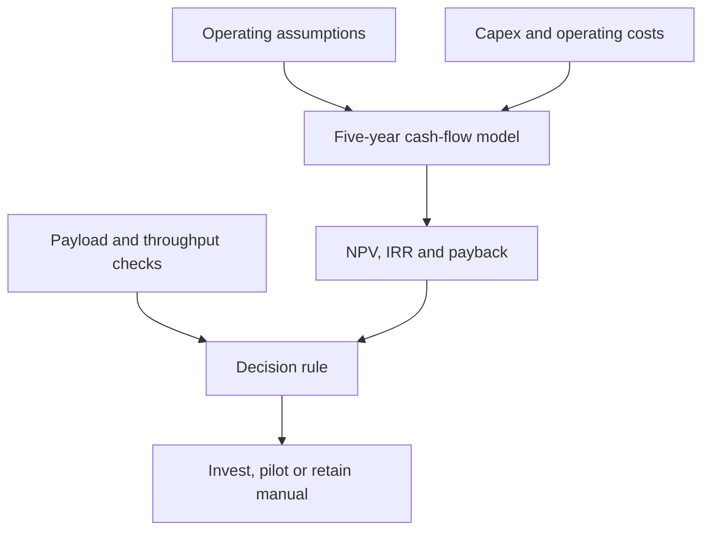
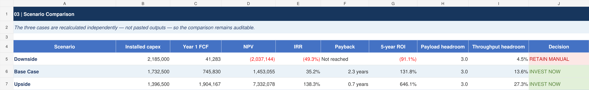
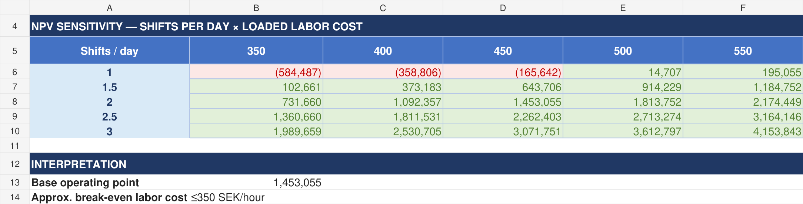

# Cobot Adoption ROI Model

**A five-year Excel decision model for automated palletizing in a hypothetical Swedish manufacturing SME.**

Version 0.2 · August 2026 · SEK · Five-year annual model

[Download the Excel model](./Cobot_ROI_Model_v0.2.xlsx)

[Read the standalone executive summary](./Cobot_ROI_Executive_Summary.md)

> **Final recommendation: RUN PILOT.** The base case is financially attractive, but the most important operating and cost assumptions still require site evidence.



*Base-case decision dashboard. The programmed rule returns `INVEST NOW`; the project recommendation remains `RUN PILOT` until the key assumptions are tested on site.*

## Executive summary

I built a five-year Excel decision model for a hypothetical Swedish manufacturer considering a UR20-based palletizing cell for 12 kg cartons. It connects shifts, loaded labor cost, uptime, labor release, throughput and installed cost to NPV, IRR, payback, five-year ROI and technical feasibility. The workbook includes three scenarios, a two-variable sensitivity matrix, a source audit and 13 internal checks.

In the base case, the installed cost is SEK 1.73 million and first-year after-tax free cash flow is SEK 0.75 million. At an 8% required return, the project produces an NPV of SEK 1.45 million, an IRR of 35.2%, a 2.28-year payback and a five-year ROI of 131.8%. The cell also retains 3 kg of payload headroom and 13.6% of throughput headroom.

The result is sensitive to operating conditions. The downside case produces an NPV of –SEK 2.04 million. With one shift and labor cost of SEK 450 per hour, NPV is –SEK 0.17 million; even at SEK 500 per hour, it is only SEK 15,000.

The model's rule returns **INVEST NOW**, but my recommendation is **RUN PILOT**. The economics look promising, while installed cost, sustained cycle rate, uptime and actual labor release remain unverified. The company should obtain a firm quote and test these factors on site. If the pilot supports the base case after the model is updated and the downside is rerun, the investment should proceed.

## Decision at a glance

| Base-case output | Result | Interpretation |
|---|---:|---|
| Installed capex | SEK 1,732,500 | Total installed cost, including 10% contingency |
| Year 1 after-tax free cash flow | SEK 745,830 | Cash benefit after operating costs and tax |
| NPV at 8% | SEK 1,453,055 | Value created after meeting the required return |
| IRR | 35.2% | Above the 8% hurdle rate |
| Payback | 2.28 years | Within the three-year decision threshold |
| Five-year ROI | 131.8% | Net five-year cash gain divided by initial capex |
| Payload headroom | 3 kg | Nominal capacity remaining after carton and tooling |
| Throughput headroom | 13.6% | Designed rate above the current line requirement |
| Model rule | `INVEST NOW` | All programmed financial and technical criteria pass |
| Final recommendation | `RUN PILOT` | Verify the assumptions before committing capital |

## Business question and scope

The model answers one question:

> Under which operating conditions does an automated palletizing cell create value for a Swedish manufacturing SME?

The decision is framed for a COO or CFO choosing between three actions: invest now, run a pilot or retain manual palletizing. The use case is end-of-line palletizing of 12 kg cartons with a UR20-based cobot cell.

This is an illustrative capital-allocation case. It is designed to show how technical requirements and operating assumptions can be translated into a financial decision. It is not a vendor quote, a site-engineering study or proof of realized savings.

## How the model reaches a decision



The core calculation path is deliberately simple and auditable:

1. **Addressable labor hours** = shifts × operating days × productive hours × operators.
2. **Realized labor savings** = addressable hours × loaded labor cost × realization rate × uptime.
3. **Free cash flow** = cash benefits − operating costs − cash tax + after-tax salvage proceeds.
4. **NPV** discounts the five annual cash flows and subtracts the initial investment.
5. The decision rule combines NPV, IRR, payback, payload, throughput and model-control checks.

## Workbook structure

| Sheet | Purpose |
|---|---|
| `00_Read_Me` | Project definition, instructions, live decision summary and limitations |
| `01_Assumptions` | Editable downside, base and upside inputs with source IDs |
| `02_Cash_Flow` | Selected-scenario cash-flow engine and investment outputs |
| `03_Scenarios` | Independently recalculated downside, base and upside cases |
| `04_Sensitivity` | NPV sensitivity by shifts per day and loaded labor cost |
| `05_Dashboard` | Executive decision dashboard and next-evidence checklist |
| `06_Sources` | Public sources, assumption ownership and validation notes |
| `07_QA` | Thirteen model-integrity and reconciliation checks |

## Base-case assumptions

| Driver | Base case | Why it matters |
|---|---:|---|
| Shifts per day | 2 | Determines how many labor hours the cell can address |
| Operating days | 240 per year | Sets the annual production window |
| Productive hours | 7.5 per shift | Excludes planned non-productive time |
| Addressable labor | 3,600 hours per year | Derived from the operating schedule |
| Loaded labor cost | SEK 450 per hour | Sets the value of each addressable hour |
| Labor-savings realization | 65% | Recognizes that not every released hour becomes cash value |
| Cell uptime | 92% | Reduces theoretical savings for unavailable time |
| Designed throughput | 250 cartons per hour | Compared with a required rate of 220 |
| Combined carton and tooling weight | 17 kg | Compared with the 20 kg nominal payload used |
| Installed capex | SEK 1,732,500 | Includes equipment, integration, training and contingency |
| Required return | 8% | Used to discount the base-case cash flows |

The base case therefore recognizes only SEK 968,760 of the SEK 1.62 million gross annual labor cost addressed:

```text
3,600 hours × SEK 450/hour × 65% realization × 92% uptime
= SEK 968,760 realized labor savings in Year 1
```

No value is assigned to safety, quality or incremental capacity in the base case because those benefits are not supported by case-specific evidence.

## Scenario results



*Each scenario is recalculated through the full cash-flow engine rather than using pasted output values.*

| Scenario | Installed capex | Year 1 FCF | NPV | IRR | Payback | Five-year ROI | Model decision |
|---|---:|---:|---:|---:|---:|---:|---|
| Downside | SEK 2,185,000 | SEK 41,283 | –SEK 2,037,144 | –49.3% | Not reached | –91.1% | `RETAIN MANUAL` |
| Base case | SEK 1,732,500 | SEK 745,830 | SEK 1,453,055 | 35.2% | 2.28 years | 131.8% | `INVEST NOW` |
| Upside | SEK 1,396,500 | SEK 1,904,167 | SEK 7,332,078 | 138.3% | 0.73 years | 646.1% | `INVEST NOW` |

The range is intentionally wide. Several operating and cost assumptions change together across the three cases, so the scenario table should be read as a boundary test rather than three forecasts.

## What the sensitivity analysis shows

The sensitivity matrix recalculates five-year NPV while changing two operating drivers: shifts per day and loaded labor cost. All other inputs remain at their base-case values.



*Values are five-year NPV in SEK. Red cells are negative; green cells are positive at the 8% base-case hurdle rate.*

| Shifts per day | Loaded labor cost | NPV | Reading |
|---:|---:|---:|---|
| 1.0 | SEK 450/hour | –SEK 165,642 | Does not meet the required return |
| 1.0 | SEK 500/hour | SEK 14,707 | Positive, but too close to break-even for a purchase |
| 2.0 | SEK 450/hour | SEK 1,453,055 | Base operating point |
| 3.0 | SEK 450/hour | SEK 3,071,751 | Stronger utilization of the same asset base |

The main implication is that utilization matters. The investment becomes more attractive when the same installed asset replaces more expensive manual hours across more shifts. A green sensitivity cell is still not proof that those hours can be removed or redeployed in practice.

## Technical screening

Two simple checks prevent the financial model from recommending a cell that fails the stated operating requirement.

**Payload headroom**

```text
20 kg nominal payload − 12 kg carton − 5 kg end effector = 3 kg
```

**Throughput headroom**

```text
(250 designed cartons/hour − 220 required cartons/hour) ÷ 220
= 13.6%
```

Both tests pass in the base case. They are screening checks, not a substitute for an engineering study. Actual payload capability also depends on the load's center of gravity, reach and motion profile, while sustained throughput depends on layout, pallet changes, stoppages, gripping performance and safety settings.

## Recommendation

The programmed decision rule returns `INVEST NOW` because the base case passes all financial, technical and model-control thresholds. I would not treat that as purchase approval.

The recommended next action is `RUN PILOT` because the main uncertainties are empirical rather than mathematical. Before committing capital, the company should:

1. Obtain a firm installed-cell quote covering scope, warranty and service.
2. Run a one-shift time and cycle study using the site's cartons, layout and pallet pattern.
3. Measure sustained throughput, uptime, stoppages, changeovers and operator intervention.
4. Confirm whether released labor creates genuine cost avoidance or measurable productive capacity.
5. Replace the provisional inputs, rerun the downside case and seek owner approval.

If the pilot supports the base-case assumptions and the economics retain an adequate safety margin, the company should proceed with the investment.

## Sources and evidence standard

The workbook separates public facts from scenario assumptions and quote placeholders.

Machine-readable audit tables are available as [`data/assumptions.csv`](data/assumptions.csv) and [`data/sources.csv`](data/sources.csv).

| Source | Use in the model | Important limitation |
|---|---|---|
| [Universal Robots — UR20 technical specifications](https://www.universal-robots.com/manuals/EN/HTML/SW5_25/Content/prod-usr-man/complianceUR20/H_g5_sections/appendix_g5/tech_spec_UR20.htm) | Nominal payload, reach and power data | Does not validate the complete cell or site performance |
| [Universal Robots — Ornua palletizing case](https://www.universal-robots.com/case-stories/ornua/) | Reference showing palletizing of products up to 12 kg | Supports technical plausibility, not the modeled economics |
| [Eurostat — hourly labour costs](https://ec.europa.eu/eurostat/statistics-explained/index.php?title=Hourly_labour_costs) | Context for the SEK 390–510 labor-cost range | Must be replaced with site payroll and overhead logic |
| [Skatteverket — declaring income](https://www.skatteverket.se/servicelankar/otherlanguages/englishengelska/businessesandemployers/nonswedishbusinesseswithoperationsinsweden/declaringincome.4.676f4884175c97df41919b9.html) | Swedish corporate tax rate used in the simplified cash-tax calculation | Company-specific tax treatment may differ |

The public sources were accessed on 10 August 2026. Installed-cell prices, maintenance, service, throughput, uptime and labor release are transparent scenario assumptions—not verified market quotes or site measurements.

## Model checks

All 13 internal controls return `OK`, and the overall workbook status is `PASS`. The checks cover scenario validity, input completeness, cash-flow signs, output reconciliations, sensitivity tie-outs, technical headroom and valid decision outputs.

`PASS` means the workbook is internally consistent. It does **not** mean that the unverified cost and operating assumptions are correct.

## Limitations

- The company and operating case are hypothetical.
- The model uses annual periods over a five-year evaluation horizon.
- Capex and recurring costs are placeholders pending supplier and integrator quotes.
- Uptime, cycle rate, line demand and labor release require site measurement.
- The cash-tax calculation is simplified and gives no tax benefit for negative incremental EBIT.
- Financing effects are excluded.
- Safety, quality and incremental-capacity benefits are excluded unless evidenced.
- The nominal payload and designed throughput checks do not replace a risk assessment or detailed integration study.

## How to use the workbook

1. Open [`Cobot_ROI_Model_v0.2.xlsx`](./Cobot_ROI_Model_v0.2.xlsx) in Excel.
2. Select `Downside`, `Base Case` or `Upside` in cell `01_Assumptions!B3`.
3. Edit blue input cells only. Yellow inputs require a quote, time study or owner confirmation.
4. Review the selected-scenario calculations in `02_Cash_Flow`.
5. Use `04_Sensitivity` to test operating conditions and `05_Dashboard` for the decision summary.
6. Confirm that `07_QA` remains `PASS` after any changes.

## Repository contents

```text
.
├── README.md
├── Cobot_ROI_Model_v0.2.xlsx
├── Cobot_ROI_Executive_Summary.md
├── data/
│   ├── assumptions.csv
│   └── sources.csv
└── assets/
    ├── executive_dashboard.png
    ├── scenario_comparison.png
    └── npv_sensitivity.png
```

## Skills demonstrated

- Five-year free-cash-flow and capital-investment modeling
- NPV, IRR, payback and ROI analysis
- Scenario design and two-variable sensitivity analysis
- Translation of payload and throughput requirements into decision gates
- Source separation, assumption ownership and model QA
- Executive communication under uncertainty

## Possible next iterations

- Replace provisional assumptions with a supplier quote and site-pilot data.
- Add a tornado chart or Monte Carlo simulation to rank uncertainty more formally.
- Model incremental capacity and quality benefits only when evidence is available.
- Compare the investment across different labor-cost and operating environments.

## Author

Robin Ling · [LinkedIn](https://www.linkedin.com/in/robin-ling-07bb94304)

This project was created as a portfolio case at the intersection of automation, operations and corporate finance.
